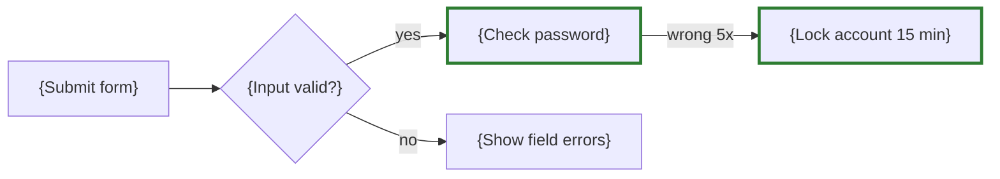
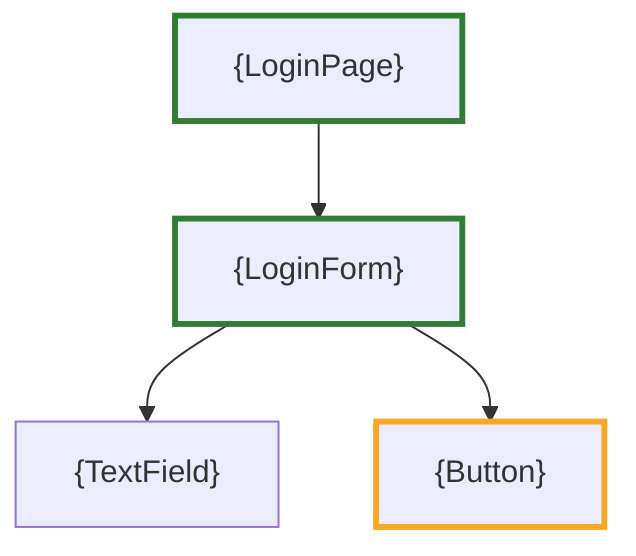
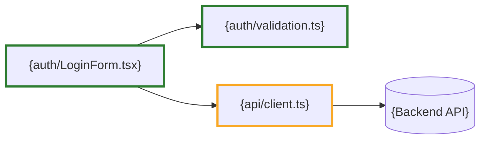

# Visuals

Patterns for visual aids and topic files of the `interview` skill. Pick the one that fits the content; leave it out if a sentence is enough. Placeholders in `{…}`.

**Highlighting:** mark what is new or changed, so the difference stands out. In Mermaid with the classes below and one legend line under the diagram ("Green: new. Yellow: changed."); in trees and lists with `new`, `changed`, `deleted` or `+` / `~` / `-`.

```
classDef new stroke:#2e7d32,stroke-width:3px
classDef changed stroke:#f9a825,stroke-width:3px
```

## Flow

Steps and branches of a process or a user action.



Short flows (2–4 steps) also work inline: `{open note}` → `{type}` → `{saved after 1 s}`.

## States

When the logic is about states rather than steps.

```mermaid
stateDiagram-v2
  [*] --> {Draft}
  {Draft} --> {Saved}: {autosave}
  {Saved} --> {Draft}: {edit}
  {Saved} --> [*]: {delete}
```

## Rules and edge cases

Every rule with a concrete example.

| Rule | Example | Result |
|---|---|---|
| {Password has at least 10 characters} | {`abc123`} | {error "too short"} |

| Case | What happens |
|---|---|
| {Empty input} | {…} |

## Layout

A screenshot from `assets/` (e.g. from a prototype), otherwise a simple ASCII wireframe.


```
┌──────────────────────────────┐
│ {Title}                      │
│ [ {Email}              ]     │
│ [ {Password}           ]     │
│ {error text under the field} │
│              [ {Log in} ]    │
└──────────────────────────────┘
```

UI states as a table: `| State | What the user sees |` (empty, loading, error, success).

## Colors

A table of roles with a swatch in front of each value. The swatch is inline HTML: the VS Code preview shows the color, GitHub strips the style and shows only the code.

| Role | Light | Dark |
|---|---|---|
| {Accent} | <span style="display:inline-block;width:.9em;height:.9em;border-radius:3px;border:1px solid #8888;vertical-align:middle;background:#0f766e"></span> `#0f766e` | <span style="display:inline-block;width:.9em;height:.9em;border-radius:3px;border:1px solid #8888;vertical-align:middle;background:#2bb5a5"></span> `#2bb5a5` |

```html
<span style="display:inline-block;width:.9em;height:.9em;border-radius:3px;border:1px solid #8888;vertical-align:middle;background:{#hex}"></span> `{#hex}`
```

## Components

Where components sit in a screen.



## Folders and files

Only the part of the tree that is touched, plus enough parent folders for orientation, each entry with its responsibility in a few words.

```
{src/}
  {auth/}                  new
    {validation.ts}        new: {checks the login form input}
    {LoginForm.tsx}        new: {the login form}
  {api/}
    {client.ts}            changed: {sends the login request}
  {legacy/}
    {old-login.ts}         deleted
```

## Dependencies

Who uses whom; existing parts only where they connect to new ones.



## Data

Entities and how they relate, plus one realistic example record.

```mermaid
erDiagram
  {USER} ||--o{ {SESSION} : has
  {SESSION} {
    string id
    datetime expiresAt
  }
```

```json
{ "id": "{s_123}", "userId": "{u_42}", "expiresAt": "{2026-12-01T10:00:00Z}" }
```

Contracts other code relies on as one-line examples: `{POST /api/login { "email": "…" } → 200 { "sessionId": "…" }}`.

## Test coverage

Which criterion is checked on which level.

| Criterion | Unit | Integration | E2E | By hand | What is checked |
|---|:-:|:-:|:-:|:-:|---|
| SC-1 | ✅ | | | | {password rules} |
| SC-3 | | | | ✅ | {form looks right in dark mode} |
