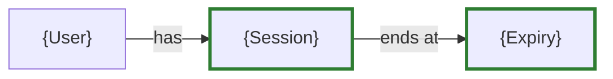

# Glossary

Terms introduced or sharpened in this interview. `maintain-glossary` takes them into `GLOSSARY.md` (or an area glossary): for a slice when the slice is closed, for a one-shot at its end.

## How the terms relate

{Optional. Only when there are several related terms: how they connect, new terms highlighted.}

## Terms

| Term | Meaning | Area | In code | Avoid |
|---|---|---|---|---|
| **{Session}** | {one login of a user, until it expires} | {global} | `{Session}` | {login, token} |

{Not to be confused with: {similar term and the difference}, if there is a real risk.}

## Changed terms

| Term | Before | Now | Why |
|---|---|---|---|
| **{Term}** | {old meaning} | {new meaning} | {reason} |
