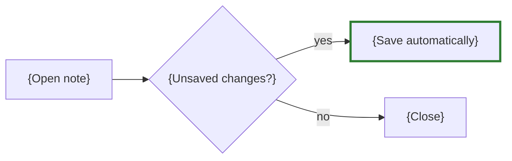

# {Topic}

{One or two sentences: what this topic covers and what came out.}

## Overview

{Optional, only if it helps: one visual that shows the result at a glance, e.g. a flow, a wireframe, a folder tree or a table of rules. Patterns in VISUALS.md of the interview skill. New and changed parts highlighted.}

Green: new.

## Decisions

### {Decision title}

- **Decision:** {what was decided, in one or two sentences}
- **Why:** {reason}
- **Rejected:** {alternative} – {why not}
- **Prototype:** {optional: what the prototype showed, screenshot from `assets/`}

### {Decision title}

…

## Details

{Optional: edge cases, rules with examples, states. Prefer a table.}

| Case | What happens |
|---|---|
| {Empty note} | {…} |
